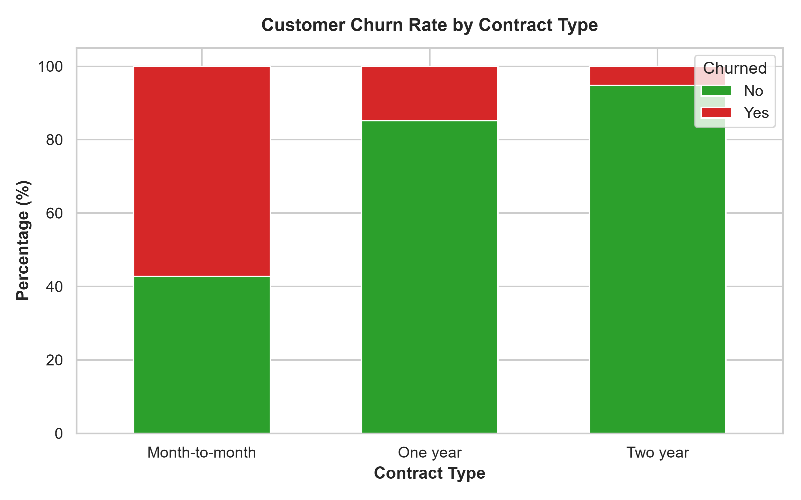
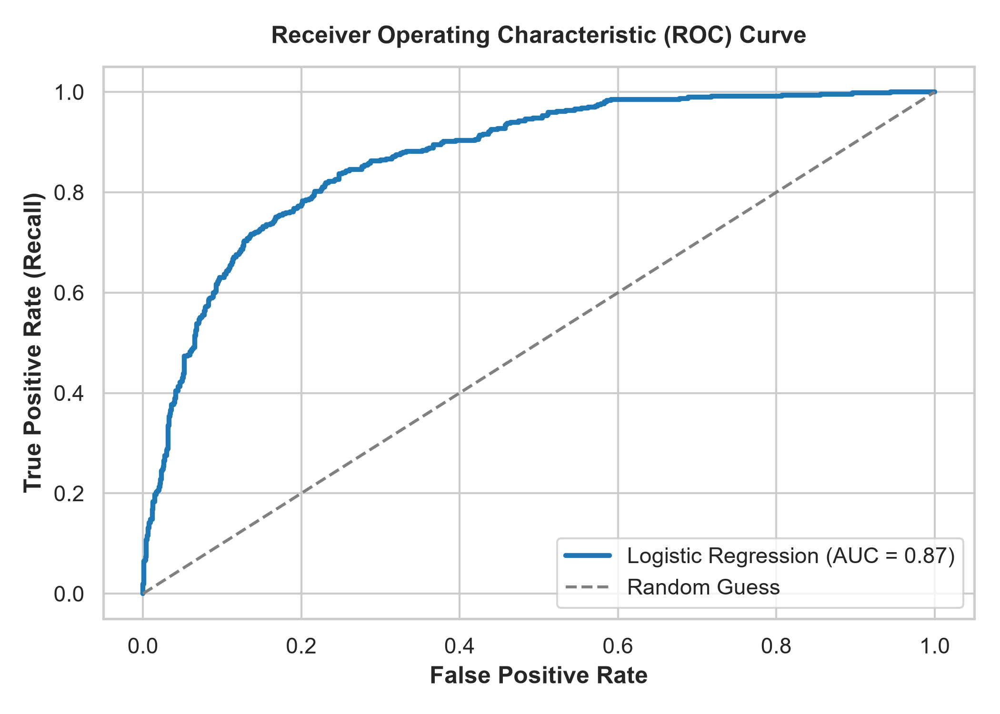
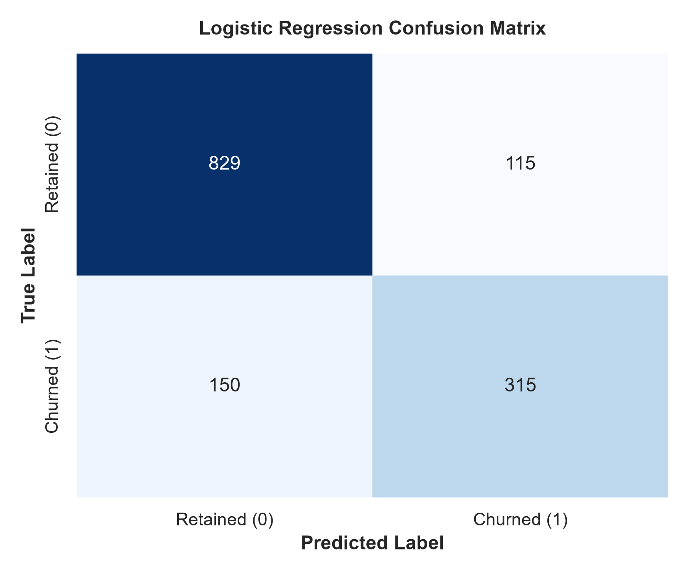
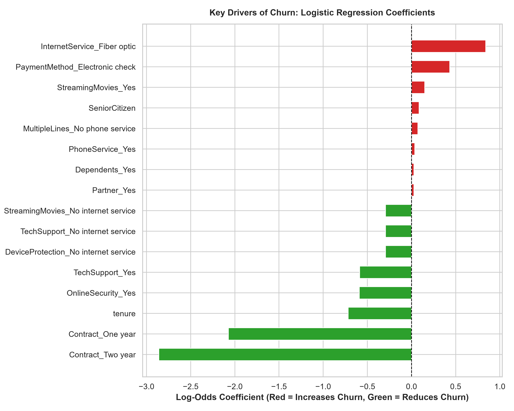

# 📞 Telecom Customer Churn Analysis & Predictive Modeling

[](https://www.python.org/)
[](https://scikit-learn.org/)
[](https://pandas.pydata.org/)
[]()
[]()

An end-to-end data analytics and machine learning project analyzing **7,043 telecom customer records** to uncover root causes of subscriber attrition and build a high-performance **Logistic Regression** model predicting customer churn with **81.2% accuracy** and **0.87 ROC-AUC**.

Developed by **Nithin K S**  
*GitHub: [@NithinKs0405](https://github.com/NithinKs0405)*

---

## 📌 Project Overview & Results
- **Dataset Size:** 7,043 customer accounts (21 attributes)
- **Model Evaluation:**
  - **Accuracy:** `81.19%`
  - **ROC-AUC Score:** `0.8698`
  - **Precision:** `73.26%`
  - **Recall:** `67.74%`
- **Core Business Finding:** Month-to-month contracts and short tenure (<12 months) represent over 70% of customer churn, while bundling Tech Support reduces churn probability by more than 50%.

---

## 🗂️ Repository Architecture

```
customer-churn-analysis/
├── data/
│   ├── raw/
│   │   └── telco_customer_churn_raw.csv        # Raw telecom customer data (7,043 rows)
│   └── processed/
│       └── cleaned_churn_data.csv              # Imputed, cleaned & validated dataset
├── notebooks/
│   └── 01_customer_churn_eda_and_modeling.ipynb # Interactive Jupyter Notebook
├── src/
│   ├── data_processing.py                      # Data cleaning & imputation pipeline
│   ├── train_model.py                          # Scikit-learn training & metrics export
│   └── predict.py                              # Customer inference & risk scoring CLI
├── models/
│   └── churn_logistic_regression.pkl           # Exported production pipeline artifact
├── visualizations/
│   ├── churn_by_contract_type.png              # Churn distribution across contracts
│   ├── tenure_vs_monthly_charges.png           # Tenure vs Charges scatter plot
│   ├── confusion_matrix.png                    # Classification confusion matrix
│   ├── roc_curve.png                           # ROC curve (AUC = 0.87)
│   └── feature_importance.png                  # Logistic Regression model coefficients
├── app/
│   └── app.py                                  # Streamlit Interactive Web Application
├── reports/
│   ├── Customer_Retention_Strategy_Report.md   # Executive retention playbook
│   └── model_performance_metrics.json          # Quantitative evaluation scores
├── requirements.txt                            # Dependencies
└── README.md                                   # Documentation
```

---

## 📊 Visual Insights & Model Findings

### 1. Churn by Contract Type

*Month-to-month contracts suffer 4x higher churn compared to 1-year and 2-year contracts.*

### 2. ROC Curve & Confusion Matrix
<p align="center">
  
  
</p>
*The Logistic Regression pipeline achieves strong discrimination power with a 0.87 ROC-AUC score.*

### 3. Key Drivers of Churn (Model Coefficients)

*Month-to-month contracts, high monthly charges, and fiber optic without support drive churn; long tenure and two-year commitments drive retention.*

---

## 💡 Retention Strategy Recommendations

1. **New Customer Onboarding (Months 1-6):** Target early-tenure accounts with complimentary 60-day trials of Tech Support and Online Security to eliminate initial configuration friction.
2. **Contract Migration Promos:** Offer a $10/month bill reduction for subscribers upgrading from Month-to-Month to a 12-Month contract.
3. **Auto-Pay Incentives:** Offer a $20 one-time credit to transition customers from electronic check to automatic ACH/Credit Card payments.

---

## 💻 Tech Stack
- **Languages & Frameworks:** Python 3.11, Streamlit
- **Data Wrangling:** Pandas, NumPy
- **Machine Learning:** Scikit-learn (`LogisticRegression`, `StandardScaler`, `OneHotEncoder`, `Pipeline`, `ColumnTransformer`)
- **Data Visualization:** Matplotlib, Seaborn, Plotly

---

## 🚀 Quickstart & Setup

### Clone Repository
```bash
git clone https://github.com/NithinKs0405/customer-churn-analysis.git
cd customer-churn-analysis
```

### Install Dependencies
```bash
pip install -r requirements.txt
```

### Run Model Training Pipeline
```bash
python src/train_model.py
```

### Launch Interactive Churn Prediction Web App
```bash
streamlit run app/app.py
```

---

## 📄 License
This project is open-source and available under the MIT License.
